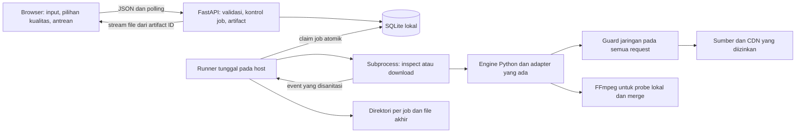
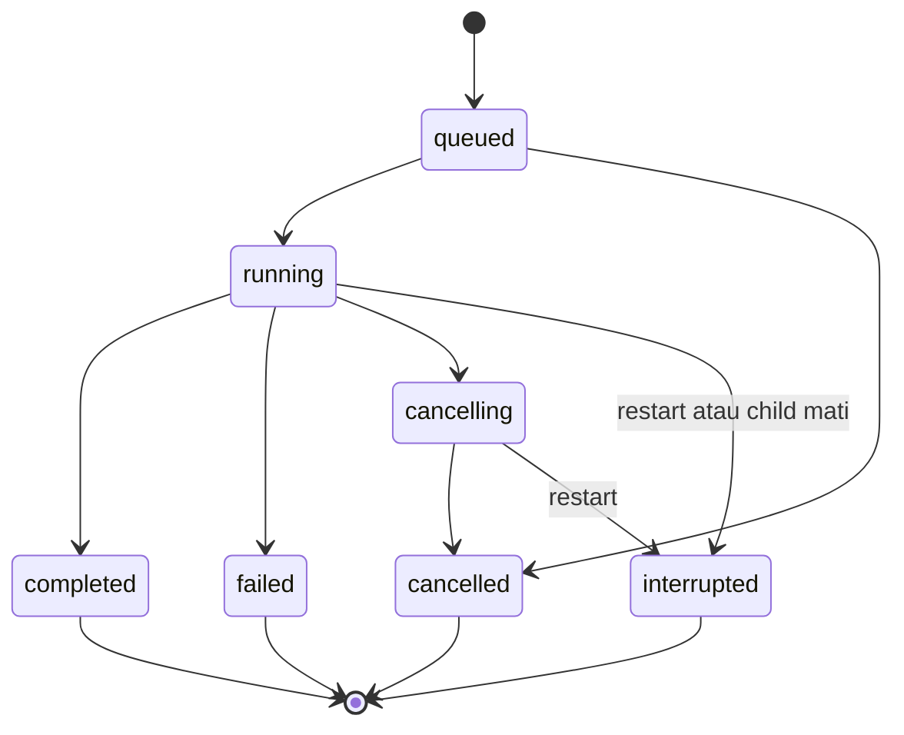

# Rencana dan skema implementasi IdlixPort Web

Tanggal: 16 November 2026. Pendamping [PRD](PRD-WEB.md). Seluruh nama modul, endpoint, dan command web di bawah adalah rancangan; belum tersedia pada source sekarang.

## 1. Arsitektur yang dipilih

Pertahankan Python, yt-dlp, adapter IDLIX, dan FFmpeg. Tambahkan FastAPI/Uvicorn, HTML/CSS/JavaScript yang disajikan dari origin yang sama, serta SQLite lokal. UI kecil ini tidak memerlukan React/Next.js atau pipeline Node pada tahap pertama.

Job tidak dijalankan di request handler atau hanya di `BackgroundTasks`. Sebuah runner yang dikelola lifecycle server memproses antrean SQLite dan meluncurkan subprocess per pekerjaan. Ini memisahkan transfer panjang dan proses FFmpeg dari event loop API. Pilihan runner lokal adalah keputusan skala MVP; dokumentasi FastAPI menjelaskan background tasks dan tradeoff sistem job terpisah [1].



Satu proses API Uvicorn, satu runner aktif, satu child job aktif. Jangan gunakan `--workers >1` atau auto-reload untuk instalasi operasional. Ambil lock OS pada data directory saat startup; instance kedua gagal jelas sebelum runner aktif. Gunakan SQLite WAL pada disk lokal, busy timeout, transaksi singkat dan klaim `UPDATE ... WHERE state='queued'` atomik. SQLite WAL mendukung pembaca bersamaan tetapi tetap satu penulis dan mensyaratkan host yang sama [3].

## 2. Pemetaan source dan batas perubahan

| Source sekarang | Peran baru/perubahan |
|---|---|
| `cli.py` | Tambahkan subcommand `web`; CLI info/download tetap tersedia |
| `downloader.py` | Tambah seam callback progres/postprocess dan pemilihan kualitas konkret tanpa mengubah semantik CLI maksimum |
| `extractor.py` | Pertahankan gate/entitlement; expose metadata kelas resolusi/asalan; request network harus melewati guard |
| `tests/test_policy.py` dan `test_next_session.py` | Pertahankan aturan CLI dan maxHeight, tambah kontrak seleksi web |
| `tests/test_integration.py` | Pakai ulang server dan media sintetis untuk tes web |

Struktur baru yang direncanakan:

```text
src/idlix_downloader/web/
  app.py              # lifecycle, routes, health, security origin/host
  schemas.py          # request/response, error codes
  repository.py       # schema SQLite, transaksi, artifact dan jobs
  runner.py           # claim antrean, subprocess, cancel, recovery
  worker.py           # entry point internal inspect/download; tidak shell
  service.py          # normalisasi inspect, cocokkan kualitas, panggil engine
  network.py          # outbound policy, integrasi request handler/transport
  static/
    index.html
    app.js
    app.css
```

Jangan rename seluruh namespace `idlix_downloader` bersamaan dengan perubahan web. Nama publik tetap IdlixPort; rename internal adalah pekerjaan terpisah bila diperlukan.

`create_downloader()` perlu menerima callback/logger melalui parameter terkontrol. `progress_hooks` dan postprocessor hooks memisahkan tahap transfer/merge; yt-dlp mendokumentasikan embedding dan hooks [2]. Jangan parse teks stdout CLI untuk mengambil progres. Worker mengirim JSON berstruktur melalui pipe, sementara stderr ditangkap dan disanitasi; runner membatasi ukuran event dan frekuensinya.

## 3. Kontrak inspeksi dan pemilihan resolusi

`POST /api/inspections` membuat job `kind=inspect` dan segera mengembalikan 202. Inspeksi memiliki timeout awal 120 detik, maksimum 12 varian dengan probe dibatasi 256 KiB per varian; kondisi melebihi batas diberi error, bukan diteruskan diam-diam. Sesuaikan setelah pengukuran.

Hasil yang boleh dikirim ke browser, contoh sintetis:

```json
{
  "inspection_id": "opaque-id",
  "source_url": "https://video.example/movie/demo",
  "title": "Demo",
  "access": {"mode": "guest", "max_height": 1080},
  "choices": [
    {
      "choice_id": "opaque-choice",
      "quality_class": 1080,
      "width": 1920,
      "height": 800,
      "evidence": "probe",
      "audio_available": true,
      "estimated_bytes": null
    }
  ],
  "expires_at": "2026-11-16T17:10:00Z"
}
```

ID pilihan bersifat server-owned dan hanya berlaku untuk hasil inspeksi itu; bukan URL atau format selector bebas. Metadata inspeksi berlaku 10 menit, tetapi sesi media tidak dianggap berlaku sepanjang waktu itu. URL manifest/segmen dan token tidak disimpan dalam database atau API response. URL input bertoken dipertahankan hanya pada storage privat untuk kebutuhan retry dan ditampilkan dengan query disamarkan.

Saat job download mulai: ekstrak ulang URL asli → filter entitlement → normalisasi ulang pilihan → cocokkan fingerprint semantik (kelas, dimensi/asal label, codec dan audio yang diperlukan). Jangan mengandalkan format ID lama: provider dapat menggantinya. Pilihan konkret harus tetap cocok; jika ambigu atau tidak tersedia, `QUALITY_CHANGED`. Metadata tinggi tidak diketahui tidak lolos pilihan 1080p konkret.

Kelas crop memakai bukti label/dimensi yang ada dan aturan lebar/tinggi yang transparan; tampilkan dimensi aktual terpisah. Jangan mensyaratkan tinggi frame selalu tepat 1080, dan jangan mengubah label 720 menjadi 1080 dengan upscale. Pertahankan batas `session_required_height` pada adapter.

`best` dan `max_1080` adalah kebijakan eksplisit berbeda dari pilihan konkret. `best` memilih ulang saat mulai; `max_1080` boleh 720 dan harus menampilkan hasil efektif. CLI `--quality 1080` tetap maksimum. Jangan mengubahnya menjadi exact melalui refactor shared code.

## 4. API minimum

| Method dan path | Perilaku |
|---|---|
| `GET /` | UI statis |
| `GET /health/live` | Proses API hidup, tanpa detail sensitif |
| `GET /health/ready` | DB, runner, FFmpeg, storage dan policy jaringan siap |
| `POST /api/inspections` | Validasi URL, enqueue probe; 202 |
| `GET /api/inspections/{id}` | State/error atau hasil metadata tersanitasi |
| `POST /api/jobs` | Buat download dari inspection dan choice; 202 |
| `POST /api/batches` | Validasi semua input, buat child jobs dan parent batch; 202 |
| `GET /api/jobs?cursor=...` | Antrean/riwayat dengan pagination |
| `GET /api/jobs/{id}` | Snapshot progres dan artifact ketika selesai |
| `POST /api/jobs/{id}/cancel` | Persist cancel request, runner menghentikan child |
| `POST /api/jobs/{id}/retry` | Job attempt baru dengan sesi baru dan resume aman |
| `GET /api/artifacts/{id}/file` | File dari mapping backend, bukan path input |
| `DELETE /api/jobs/{id}` | Hapus job terminal dan artifact saat tidak sedang dikirim |

Tambahkan `Idempotency-Key` pada create download/batch untuk klik ganda. Key sama+payload sama mengembalikan hasil yang sama; payload berbeda mengembalikan 409. Error JSON: `code`, `message`, `retryable`, `action`; detail internal tidak masuk response. Queue penuh 429, invalid input 422, state conflict 409, dependency/storage belum siap 503.

Contoh error domain: `SOURCE_UNAVAILABLE`, `ACCESS_LIMITED`, `QUALITY_CHANGED`, `UNKNOWN_RESOLUTION`, `SESSION_EXPIRED`, `DISK_FULL`, `CANCELLED`, `NETWORK_BLOCKED`, `FFMPEG_MISSING`. Klasifikasi `ACCESS_LIMITED` hanya jika sumber memberi bukti, bukan untuk setiap 403.

## 5. Data dan lifecycle pekerjaan

SQLite schema awal memakai `PRAGMA user_version`, dibuat secara transaksional saat start:

- `jobs`: id, kind, batch_id, source_url, inspection_id, choice_spec_json, policy, state, phase, attempt, retry_of, resume_root, created_at, started_at, finished_at, cancel_requested, heartbeat_at, downloaded_bytes, total_bytes nullable, speed nullable, eta nullable, effective_quality_json, error_code, safe_message.
- `inspections`: job_id, normalized_metadata_json, created_at, expires_at. Tidak menyimpan manifest/session response mentah.
- `artifacts`: id, job_id, relative_path, size_bytes, media_type, dimensions_json, stream_summary_json. Subtitle sebagai artifact terpisah.
- `idempotency_keys`: key, request_hash, response_id, created_at. Hapus key yang melewati masa retensi yang ditentukan.



Phase di dalam running: `extracting`, `waiting_source`, `downloading`, `merging`, `validating`. Retry membuat attempt baru, tidak menghapus hasil attempt sebelumnya. Setelah restart, queued tetap antre; job running/cancelling menjadi interrupted setelah instance lock memastikan tidak ada worker lama. Tidak auto-retry semua interrupted agar permintaan besar tidak mulai tanpa diketahui pengguna.

Cancel: runner persist niat cancel → signal process group → tunggu maksimum 5 detik → kill bila perlu → tunggu exit → tulis cancelled. Di Windows gunakan process tree termination yang setara; jangan mengklaim dukungan sebelum diuji. Startup/shutdown menghentikan seluruh child; orphan tidak boleh memegang file ketika recovery.

Progress transfer dibatasi update sekitar 1×/detik. Bila total tidak diketahui tampilkan byte dan kecepatan tanpa persen palsu. Update progres bukan transaksi panjang. Status completed baru setelah validasi artifact dan commit database.

## 6. Penyimpanan, resume, dan pengiriman file

Root data awal `./data/`; file baru `data/downloads/<job-root>/`. Jangan otomatis memindahkan folder `downloads/` CLI lama. Tambahkan `data/`, `.env`, database, dan log privat ke `.gitignore` sebelum runtime baru digunakan.

Path selalu dibentuk backend dan dibatasi di root, termasuk setelah resolve symlink. Nama file berasal dari template engine yang disanitasi. API tidak menerima output path, path cookies, binary FFmpeg, atau argumen shell dari browser.

Retry boleh menggunakan direktori parsial milik attempt sebelumnya hanya jika identitas video, pilihan kualitas, dan layout stream kompatibel. Jika fingerprint berbeda, buat direktori baru dan pertahankan parsial lama. Sesi/manifest baru tidak otomatis membuktikan `.part` aman dilanjutkan. Uji HTTP Range, fragmen HLS, perubahan format, token kedaluwarsa, dan hash akhir.

File akhir hanya tersedia setelah worker selesai. Gunakan FileResponse/streaming dari artifact lookup; FastAPI mendokumentasikan Content-Disposition dan streaming file [4]. Uji Range pada versi Starlette terpilih sebelum menjanjikan resume browser. Jangan memuat file ke RAM. Saat artifact sedang dikirim, tolak penghapusan atau tunda sampai handle ditutup; jangan hapus otomatis setelah satu GET.

FFmpeg melakukan remux/merge, bukan upscale. Probe menerima input sampel melalui stdin dengan batas byte/timeout; merge hanya berkas lokal. Validasi stream/durasi memakai FFprobe jika tersedia atau pemeriksaan FFmpeg yang sesuai; rilis harus menetapkan satu mekanisme yang benar-benar terpasang, karena extra portable saat ini menyediakan FFmpeg dan tidak menjamin FFprobe.

## 7. Kebijakan jaringan dan deployment

Permukaan web membuat URL input menjadi risiko SSRF. Skema HTTP(S) saja dari `validate_url()` tidak cukup. Ikuti kontrol jaringan menyeluruh, termasuk DNS dan redirect [5].

Untuk MVP web, batasi entry point pada adapter IDLIX dan direct media; domain halaman/provider/CDN yang didukung dicatat di konfigurasi operator. Jangan mengaktifkan generic extractor tanpa menelusuri seluruh jalur request-nya. Allowlist domain tidak menggantikan validasi IP.

Implementasi guard harus menolak alamat nonpublik IPv4/IPv6, loopback, private, link-local, multicast, reserved dan metadata; memeriksa semua hasil DNS; mengikat koneksi ke IP yang sudah divalidasi sambil mempertahankan TLS hostname/SNI; dan memvalidasi ulang setiap redirect. Berlaku pada metadata API, redeem provider, playlist, nested playlist, segmen, key dan subtitle. Guard level form yang tidak mengontrol koneksi tidak cukup untuk DNS rebinding.

Tahap pertama adalah spike request handler yt-dlp pada versi yang dipatok untuk membuktikan semua request melewati guard. Jangan mengasumsikan callback validasi URL mencakup FFmpeg atau jalur downloader lain. Gunakan native HTTP/HLS/DASH yang sudah terjaga; FFmpeg tidak boleh mengambil URL jaringan langsung dalam mode web. Jika ini tidak dapat dibuktikan, blok mode web produksi sampai transport atau egress isolation diuji. Tes lokal memakai transport khusus fixture, bukan pengecualian localhost yang dapat dipilih pengguna produksi.

Loopback: bind `127.0.0.1`, validasi Host, CSRF/Origin mutasi, rate limit, batas body/batch, akses file terbatas. Output judul memakai textContent/escaping, bukan HTML sumber. Dependency versions dipilih dan dikunci pada implementasi setelah compatibility check.

Self-hosted pribadi jarak jauh baru setelah MVP: reverse proxy HTTPS, autentikasi operator/VPN, volume persisten dan quota disk. Publik multiuser memerlukan ownership job/artifact, otorisasi, quota per pengguna, dan isolasi worker. Jangan expose server localhost dengan tunnel publik sebagai pengganti desain itu.

## 8. Tahapan implementasi dan gate selesai

Estimasi indikatif satu engineer, bukan janji durasi; API sumber, keamanan transport, dan token renewal bisa mengubahnya.

| Tahap | Pekerjaan | Gate selesai | Perkiraan |
|---|---|---|---|
| 0 — Bukti sumber | Baseline tes; guest inspect beberapa film target; catat tier/maxHeight/varian tanpa cookies; satu sumber uji 1080p tanpa login | Matriks bukti guest; putuskan apakah target IDLIX 1080p mungkin | 0,5–1 hari |
| 1 — Kontrak engine dan jaringan | Quality choice, hooks, safe logger, cancellation subprocess, spike guard semua request | Tes entitlement/seleksi lama lulus; SSRF redirect/rebinding/segmen diblok | 2–3 hari |
| 2 — Satu alur web | API, SQLite, runner satu child, input → inspect → pilih → download → artifact | Sumber sintetis 1080p diunduh sampai selesai via browser | 2–3 hari |
| 3 — Reliability | Cancel, retry/resume kompatibel, recovery, disk penuh, token error, idempotency | Fault injection lulus; tidak orphan/status sukses palsu | 1–2 hari |
| 4 — Batch dan UX | Antrean batch, polling/backoff, subtitle, riwayat, hapus file, mobile | Satu film gagal tidak menghentikan batch; refresh aman | 1–2 hari |
| 5 — Packaging dan rilis | Extra web, command start, runbook, clean install, bukti aktual | Install baru → browser → file, tanpa langkah tersembunyi | 0,5–1 hari |

Total awal sekitar 7–12 hari kerja setelah akses sumber jelas. Bila tahap 0 menunjukkan guest maksimal 720p, jangan menandai A15 selesai atau memperpanjang waktu seolah penambahan UI akan mengatasinya. Bila guard jaringan terlalu besar untuk estimasi tahap 1, revisi estimasi sebelum merilis endpoint pengambil URL.

## 9. Rencana menjalankan hasil implementasi

Target packaging: extra `web` berisi FastAPI/Uvicorn; `portable` tetap FFmpeg. Command yang direncanakan, belum tersedia sekarang:

```bash
cd /Users/syahrul/Documents/SoftwareDev/IdlixPort
python3 -m venv .venv
source .venv/bin/activate
python -m pip install -e '.[web,portable]'
idlixport doctor
idlixport web --host 127.0.0.1 --port 8765 --data-dir ./data
```

Buka `http://127.0.0.1:8765`. Perintah `web` menyiapkan database, mengambil instance lock, memulai runner, dan menampilkan error dependency/storage sebelum menerima job. Tanpa Redis, command worker manual, atau Node build.

Runbook verifikasi rilis: readiness sukses → tempel sumber uji → inspect → pilih 1080p → download → tunggu completed → simpan → verifikasi stream dan hash → ulangi cancel/restart/retry → cek CLI lama. Uji film IDLIX guest terpisah dan rekam hasil sebenarnya, termasuk jika hanya 720p.

## 10. Strategi uji dan rollback

- Unit: normalisasi pilihan, exact vs maximum, dimensi crop, metadata tidak diketahui, entitlement, state transition, error redaction, idempotency.
- API/storage: validasi, antrean penuh, expiry inspect, pagination, collision claim, cancel race, akses artifact/path dan origin.
- Integrasi: server media sintetis 720/1080/audio terpisah; merge; HTTP Range; HLS token; URL berubah saat mulai; disk penuh; kill child; restart API; token expiry. Test fixture jaringan tidak mengubah kebijakan produksi.
- Browser: satu alur nyata pada desktop dan mobile viewport, refresh tab, error sumber, simpan hasil, cancel saat merge, dan polling pulih setelah API terputus.
- Keamanan transport: semua jalur request termasuk redirect, nested manifests, key dan subtitle, DNS rebinding serta IPv6. Jika jalur tak terjaga, acceptance gagal.
- Live: opt-in metadata dan probe terbatas untuk guest; tidak mengunduh film penuh dalam CI. Validasi full transfer hanya pada media yang diizinkan. Catat batas bukti dan tanggal.

Rollback source: extra web dan command web dipisahkan; CLI tetap berfungsi. Backup database menggunakan SQLite backup API atau setelah shutdown bersih, bukan copy file DB aktif tanpa WAL. Versi schema diperiksa saat start; versi baru yang tidak dikenali ditolak. Jangan hapus data atau parsial saat rollback. Tidak memerlukan migrasi konten lama untuk rilis pertama.

Batas selesai pekerjaan implementasi: A1–A14 PRD terbukti, panduan clean install berjalan, dan A15 dilaporkan sesuai bukti. Jika syarat mutlak pengguna adalah A15, pekerjaan keseluruhan belum selesai sampai A15 benar-benar terpenuhi; jangan menyamakan kesiapan engine 1080p dengan akses IDLIX guest 1080p.

## 11. Referensi teknis primer

1. [FastAPI Background Tasks](https://fastapi.tiangolo.com/tutorial/background-tasks/) — lifecycle background tasks dan tradeoff pekerjaan berat.
2. [yt-dlp embedding](https://github.com/yt-dlp/yt-dlp#embedding-yt-dlp) — Python API dan progress hooks.
3. [SQLite WAL](https://www.sqlite.org/wal.html) — konkurensi, satu host dan batas filesystem.
4. [FastAPI FileResponse](https://fastapi.tiangolo.com/advanced/custom-response/#fileresponse) — pengiriman file dan header.
5. [OWASP SSRF Prevention](https://cheatsheetseries.owasp.org/cheatsheets/Server_Side_Request_Forgery_Prevention_Cheat_Sheet.html) — validasi jaringan, domain/IP, dan redirect.

Dokumentasi diperiksa 16 November 2026; kontrak implementasi harus dicocokkan lagi dengan versi dependency yang benar-benar dipasang.

## 12. Baseline analisis saat ini

Pada 16 November 2026, `.venv/bin/python -m pytest -q -p no:cacheprovider` berhasil: **62 passed in 5.86s**. Pengujian awal dalam sandbox menerima 8 error setup karena bind server HTTP loopback ditolak; pengulangan dengan izin server lokal membuat semua tes lulus. Ini bukti engine lokal sebelum perubahan web, bukan bukti akses IDLIX guest 1080p. Tidak ada perubahan runtime pada pekerjaan penyusunan dokumen ini.
