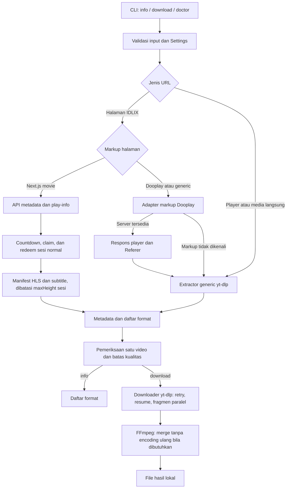

# Kebutuhan dan rancangan teknis

## Tujuan dan asumsi

Pengguna ingin aplikasi Python untuk mengunduh banyak film IDLIX pada 1080p atau resolusi tertinggi yang benar-benar tersedia, dengan waktu pengembangan dan biaya pemeliharaan rendah. MVP berupa CLI lokal yang menerima satu URL, beberapa URL, atau file daftar film. Dashboard web, sistem akun aplikasi sendiri, dan layanan server tidak diperlukan. Sesi login situs dapat digunakan untuk mengakses kualitas yang tersedia bagi akun pengguna.

Target verifikasi pengguna adalah `https://z2.idlixku.com/movie/the-last-10-years-2022`. Pemeriksaan awal curl menghasilkan HTTP 403, tetapi sesi HTTP yt-dlp berhasil membaca halaman dan API publik. Situs target menggunakan Next.js dan sesi player Pentos. Pada 22 Oktober 2026, sesi tamu mengiklankan batas 720p, dengan format 360p/720p dan subtitle Indonesia. Halaman target tidak memakai markup Dooplay. Adapter Dooplay tetap tersedia untuk pola markup lama dan diuji dengan fixture.

Pengguna mengonfirmasi bahwa 1080p memerlukan login dan tidak tersedia pada semua film. Karena itu, aplikasi harus memakai sesi login untuk memeriksa akses 1080p dan tetap memilih berdasarkan varian yang tersedia pada film tersebut. Login tidak dianggap sebagai bukti bahwa sumber film memiliki varian 1080p.

## Kebutuhan fungsional

1. Menerima URL HTTP(S) halaman film, player yang didukung, atau media langsung.
2. Memperlihatkan judul, daftar format, resolusi, container, dan ukuran jika tersedia tanpa mengunduh seluruh video.
3. Memilih resolusi maksimum 1080p secara default. `best` menghilangkan batas untuk sumber dengan resolusi lebih tinggi.
4. Mempertahankan kualitas sumber. Tidak melakukan upscale atau encoding ulang untuk mengejar label resolusi.
5. Memilih server Dooplay berdasarkan urutan tampil, jika pola markup yang dikenali tersedia.
   Pada situs Next.js, membaca metadata film dan mengikuti alur sesi normal dengan batas resolusi sesuai hak akses akun.
6. Mengunduh video dan audio, kemudian menggabungkan keduanya jika terpisah.
7. Menampilkan progres melalui yt-dlp, menerapkan retry terbatas, dan melanjutkan unduhan yang terputus jika sumber mendukungnya.
8. Mengatur folder hasil dan jumlah fragmen paralel.
9. Menyimpan subtitle Indonesia/Inggris yang diberikan extractor jika diminta.
10. Memberikan pesan kegagalan yang dapat ditindaklanjuti dan exit code yang sesuai.
11. Menerima batch dari beberapa argumen URL atau `--batch-file`, mengabaikan duplikat persis, dan memvalidasi seluruh daftar sebelum akses jaringan.
12. Memproses film berurutan dengan satu sesi downloader; satu film gagal tidak menghentikan film berikutnya. Setiap film tetap memilih kualitas berdasarkan sumber dan akses sesinya sendiri.

## Kebutuhan nonfungsional

- Dependensi runtime inti hanya yt-dlp. Standard library menyediakan CLI, validasi URL, dan parsing markup adapter. FFmpeg tersedia dari sistem atau extra portable.
- Tidak ada database, Redis, Docker, API server, frontend JavaScript, atau browser automation pada MVP.
- Penggunaan RAM terutama mengikuti buffer downloader; video tidak dimuat seluruhnya ke memori aplikasi.
- Paralelisme dibatasi maksimal 16 fragmen untuk mencegah konfigurasi berlebihan. Default delapan merupakan titik awal yang harus disesuaikan dengan sumber.
- TLS tetap diverifikasi. URL non-HTTP(S) dan kredensial dalam URL input ditolak. Tidak ada eksekusi shell dari input URL.
- File cookies tidak dimasukkan ke source control. Informasi lengkap URL media bertoken tidak disimpan sebagai metadata JSON secara otomatis.
- Versi yt-dlp dipatok agar hasil instalasi konsisten. Pembaruan extractor dilakukan lewat perubahan versi yang diuji kembali.

## Arsitektur

`cli.py` memiliki parsing argumen, output terminal, dan pemetaan error. `downloader.py` memiliki kebijakan kualitas, lifecycle downloader, validasi satu video, dan deteksi FFmpeg. `extractor.py` memiliki parsing markup dan resolusi player. Pemisahan ini menjaga perubahan domain atau player tidak mengubah kebijakan kualitas.

Alur batch memakai jalur pengunduhan per film yang sama dengan mode satu URL. CLI membaca daftar UTF-8, membuang komentar/baris kosong dan duplikat persis, lalu memvalidasi seluruh input. `download_videos` membuka satu downloader dan memproses URL secara berurutan. Cookies dibaca oleh sesi yang sama; claim dan URL media baru diminta ketika setiap film mulai diproses. Error per film dikembalikan sebagai hasil batch, sedangkan Ctrl+C tetap menghentikan seluruh proses. Ringkasan disajikan di terminal tanpa database antrean atau berkas riwayat tambahan.

Adapter menggunakan sesi HTTP yt-dlp untuk meneruskan cookies dan konfigurasi jaringan. Pada markup Dooplay yang didukung, adapter membaca atribut `data-post`, `data-nume`, `data-type`, mengabaikan trailer yang diberi penanda `trailer`, lalu meminta player melalui endpoint AJAX standar. Respons yang didukung berisi `embed_url` berupa URL atau satu iframe. Provider atau markup lain tetap bergantung pada extractor yt-dlp. Mirror tanpa nama IDLIX memerlukan `--page-adapter` untuk memakai adapter ini.

Pada halaman `/movie/` Next.js, adapter membaca `/api/movies/{slug}`, kemudian `/api/watch/play-info/movie/{id}`. Respons `gate` diikuti dengan waktu tunggu berdasarkan `unlockAt - serverNow`, lalu POST `/api/watch/session/claim`. Claim Pentos ditukarkan melalui endpoint HTTPS provider `majorplay.net` yang diberikan API. Manifest dan subtitle dibaca melalui URL sesi yang dihasilkan. Endpoint ini mengikuti modul JavaScript publik halaman target yang diperiksa, bukan dokumentasi API resmi yang stabil.

Adapter tidak mengubah tier pengguna atau batas `maxHeight`. Sesi tamu target dibatasi 720p. Cookies dari browser hanya dibaca bila pengguna memilih `--cookies-from-browser`; aplikasi tidak mengambil sesi browser secara otomatis. Tidak ada mekanisme untuk menyelesaikan CAPTCHA. API dapat berubah dan menuntut verifikasi yang harus dilakukan pengguna di browser.

## Kebijakan kualitas dan container

Untuk `1080`, format selector adalah `bv*[height<=1080]+ba/b[height<=1080]`. Tinggi yang tidak diketahui ditolak agar batas tidak dilanggar diam-diam. Untuk `best`, selector adalah `bv*+ba/b`. Sorting mengutamakan resolusi, frame rate, kemudian bitrate, dengan prioritas internal yt-dlp yang tetap berlaku.

Tidak ada fallback tanpa batas pada mode angka. Jika hanya tersedia 2160p, permintaan maksimum 1080p gagal karena aplikasi tidak melakukan transcoding. Jika sumber hanya memiliki 720p, aplikasi menghasilkan 720p. Resolusi yang diiklankan manifest bukan bukti mutu visual asli; sumber dapat memakai upscale atau bitrate rendah.

Sebagian manifest menggunakan label `360p`/`720p` tanpa atribut `RESOLUTION`; adapter memakai label eksplisit itu sebagai metadata tinggi sebelum seleksi. Manifest film lain hanya berisi bitrate. Jika label dan dimensi sama-sama tidak tersedia, adapter membaca maksimal 256 KiB dari satu segmen atau init per varian dan meminta FFmpeg mengidentifikasi dimensi melalui stdin, dengan timeout 15 detik. Playlist terenkripsi dan sampel yang tidak dapat diperiksa menghasilkan error yang jelas. Varian sinema yang terpotong vertikal juga memperhitungkan lebar frame terhadap kelas 16:9 saat menerapkan batas sesi, sehingga frame lebar 1920 piksel tidak dianggap kelas 720p hanya karena tinggi hasil crop kurang dari 720. Audio tanpa video tetap dapat dipilih bersama video yang memenuhi batas.

Cuplikan live dari varian berlabel 720p terbaca sebagai H.264 1280×536 dengan audio AAC Jepang. Angka 720p adalah kelas kualitas sumber; frame film dapat lebih pendek karena rasio sinema tanpa bar hitam. CLI menandai resolusi yang berasal dari label manifest agar tidak disamakan dengan pengukuran frame.

URL master provider membawa parameter otorisasi `t` dan `pm`; playlist relatif tidak mengulang query tersebut. Adapter meneruskan query sesi asli ke playlist turunan pada host yang sama, serta ke permintaan segmen dan key HLS. Regresi ini diuji dengan server lokal yang menolak permintaan tanpa token.

MKV digunakan saat perlu menggabungkan stream karena kompatibilitas codec luas. File yang sudah memiliki audio dan video dipertahankan. FFmpeg melakukan merge/remux, sehingga CPU tidak dihabiskan untuk encoding ulang.

## Performa dan kapasitas

Kecepatan akhir dibatasi throughput server/CDN, bandwidth pengguna, latensi, rate limit, dan disk. Delapan fragmen paralel membantu mengisi bandwidth ketika satu koneksi menjadi bottleneck, tetapi tidak menjanjikan peningkatan delapan kali lipat. Pada sumber yang memakai FFmpeg sebagai downloader eksternal, pengaturan fragmen native tidak selalu berlaku.

Perkiraan ukuran: `durasi_detik × bitrate_total_Mbps / 8` menghasilkan MB desimal. Film dua jam dengan bitrate total 5 Mbps sekitar 4,5 GB. Pada koneksi efektif 20 Mbps, waktu transfer teoretis minimal sekitar 30 menit, sebelum overhead, pembatasan server, dan merge. Ini perhitungan kapasitas, bukan benchmark situs target.

Sediakan ruang kosong sekitar 2–2,5 kali ukuran akhir ketika stream terpisah perlu digabungkan. Ruang aktual bergantung pada container dan proses postprocessing. Hindari pengunduhan banyak film serentak sebelum throughput dan rate limit sumber diketahui.

## Acceptance criteria dan bukti

- Fixture yang menyediakan 720p/1080p/2160p menghasilkan 1080p untuk mode default dan 2160p untuk `best`.
- Fixture video dan audio terpisah menghasilkan file akhir yang dapat dibaca FFmpeg dan mengandung kedua stream.
- Metadata tinggi yang tidak diketahui tidak lolos batas 1080p, tetapi dapat dipilih dengan `best`.
- Pilihan server menghasilkan payload server yang sesuai dan meneruskan Referer pada jalur generic.
- Stream langsung dengan Referer dapat diproses tanpa memerlukan domain IDLIX.
- Live stream dan playlist tidak memulai download media.
- Konfigurasi yang tidak valid gagal sebelum akses jaringan.
- Kegagalan akses HTTP 403 dilaporkan sebagai kegagalan, bukan keberhasilan unduhan.
- Metadata live URL pengguna berhasil dibaca: judul, format 360p/720p, subtitle Indonesia, dan batas sesi 720p. Pengujian transfer live dibatasi cuplikan untuk menghindari pengunduhan seluruh film sebagai bagian tes.
- Sesi akun dan akses 1080p pengguna belum diuji; screenshot login tidak membuktikan hak akses resolusi tertentu.
- Batch dengan satu URL gagal tetap mengunduh film berikutnya menggunakan sesi yang sama. File input dengan URL tidak valid ditolak sebelum pengunduhan apa pun.
- URL duplikat persis dalam argumen/file hanya diproses sekali. Ringkasan dan exit code membedakan batch berhasil seluruhnya dari batch dengan kegagalan.

## Urutan pengembangan dan batas selesai

Tahap pertama membuktikan engine media: format selection, transfer, merge, dan penanganan kegagalan. Tahap kedua mengisolasi adapter halaman dan menguji payload server dengan fixture. Pemeriksaan URL pengguna kemudian mengungkap kebutuhan adapter Next.js/Pentos; adapter tersebut sudah ditambahkan dan manifest live berhasil dibaca.

MVP berhenti pada jalur CLI yang dapat dijalankan dengan bukti lokal dan pemeriksaan live terbatas. GUI, pencarian katalog, batch episode, pemindaian semua server, antrean persisten, browser automation, transcoding, dan DRM tidak termasuk. URL sesi tamu target memiliki TTL 3600 detik. Renewal token tersedia dalam respons situs, tetapi pembaruan token selama transfer belum diimplementasikan; proses yang terputus meminta sesi baru saat perintah dijalankan ulang. Resume lintas sesi live belum diuji. Fitur tambahan memerlukan bukti kebutuhan yang membenarkan kompleksitasnya.

## Referensi teknis

- [Dokumentasi resmi yt-dlp](https://github.com/yt-dlp/yt-dlp#readme): embedding Python, format selection, retry, resume, dan concurrent fragments.
- [Parameter resmi YoutubeDL](https://github.com/yt-dlp/yt-dlp/blob/master/yt_dlp/YoutubeDL.py): kontrak API engine.
- [Daftar extractor yt-dlp](https://github.com/yt-dlp/yt-dlp/blob/master/supportedsites.md): dukungan generic tidak menjamin URL tertentu dapat diproses.
- [FFmpeg](https://ffmpeg.org/): penggabungan dan pemeriksaan media.
